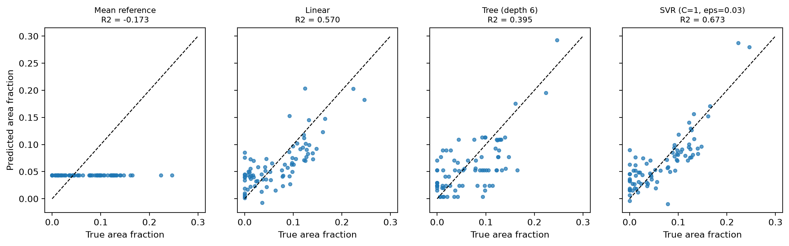

# MMA3001 Meat Quality

Estimate the severity of packaging defects on a pork rasher tray from a single photo, then turn it into a pass/fail screening decision.

Individual project for MMA3001 Numerical Methods and Machine Learning, Monash University.
Report: [report/MMA3001_report.pdf](report/MMA3001_report.pdf) | Code documentation: [docs/index.html](docs/index.html)

## What it is for

Food packaging lines need automated inspection. This tool predicts the **defect area fraction** of a tray photo: the total area of annotated defect boxes as a share of the image (0 to 1). It compares that number with a threshold (default 0.04) to give pass or fail. It is a severity score and screening aid. It does not locate defects and does not replace an inspector.

## Results

| Model | Test R² | Test RMSE |
| --- | --- | --- |
| Mean reference | -0.173 | 0.0614 |
| Linear regression | 0.570 | 0.0372 |
| Decision tree (depth 6) | 0.395 | 0.0441 |
| **SVR, RBF (selected)** | **0.673** | **0.0324** |

Test set: 80 images. At threshold 0.04 the SVR gets a fail recall of 0.779 and a pass recall of 0.667. See the report for uncertainty, robustness and limitations.



## Features

- Input: one RGB image, 720 x 540 pixels, `.jpg`, `.jpeg` or `.png`
- Output: `predicted_area_fraction` (0 to 1), `decision` (pass or fail) and `threshold`
- 48 hand-built features: HSV colour histograms and finite-difference edge strength
- Linear, decision tree and SVR models compared against a predict-the-mean baseline
- Bootstrap confidence intervals, brightness and blur robustness tests, failure-case analysis
- Input validation: bad files are rejected with a clear error and never guessed at
- Profiled feature extraction (about 29% faster, identical output)
- 39 unit tests with hand-computed expected answers

## Installation

```
git clone https://github.com/rdas0013/mma3001-meat-quality.git
cd mma3001-meat-quality
python -m venv .venv
```

Activate the environment:

- Windows: `.venv\Scripts\activate`
- Mac or Linux: `source .venv/bin/activate`

Then install and check:

```
pip install -r requirements.txt
pip install -e .
pytest
```

## Quick start

A trained model (`models/svr_model.joblib`) and sample images (`data/samples/`) are included, so you can try it straight away:

```
python scripts/assess_cli.py data/samples/sample1.jpg
```

Example output:

```
{'image': 'tray.jpg', 'predicted_area_fraction': 0.0757, 'decision': 'fail', 'threshold': 0.04}
```

A rejected input looks like this:

```
REJECTED notes.md: Unsupported file type '.md'; use ['.jpeg', '.jpg', '.png']
```

From Python:

```python
from meatqa.assess import assess_image, load_model
bundle = load_model("models/svr_model.joblib")
print(assess_image("data/samples/<sample>.jpg", bundle))
```

| | |
| --- | --- |
| Input | RGB image, 720 x 540, `.jpg`, `.jpeg` or `.png` |
| Output | `predicted_area_fraction` (fraction of image area, >= 0), `decision`, `threshold` |
| Errors | `FileNotFoundError` for a missing file; `ValueError` for an unsupported type, unreadable file or wrong size |

## Reproducing the experiments

The dataset is not stored here. Download **Pork Rasher Error (Packaging), version 4, YOLOv8 format** from
https://universe.roboflow.com/hello-2aqe0/pork-rasher-error-packaging
(licence CC BY 4.0) and extract it so that `data/train`, `data/valid`, `data/test` and `data/data.yaml` exist. Then:

```
python scripts/make_filtered_train.py data
python scripts/extract_features.py data
python scripts/train_final_model.py
python scripts/compare_models.py
python scripts/tune_models.py
python scripts/make_figures.py
```

Outputs are written to `results/`.

## How it works

1. Check the image type, size and readability.
2. Extract 48 features: 32 colour-histogram values (16 hue, 8 saturation, 8 value bins) and 16 edge values (mean gradient magnitude on a 4 x 4 grid).
3. Standardise with a scaler fitted on training data only.
4. Predict with an RBF support vector regression (C = 1, epsilon = 0.03).
5. Clip at 0 and compare with the threshold (0.04, chosen on the validation split).

## Repository layout

| Path | Contents |
| --- | --- |
| `src/meatqa/` | Library code with docstrings |
| `scripts/` | One script per experiment, writing to `results/` |
| `tests/` | pytest tests |
| `results/` | Experiment outputs, figures and the pytest report |
| `docs/` | Generated HTML documentation (pdoc) |
| `report/` | Project report (PDF) |
| `models/` | Trained model |
| `data/samples/` | A few sample images |

Regenerate the documentation with `pdoc -d google meatqa -o docs`.

## Known limitations

- The test set has only 80 images, so every metric is noisy.
- Predictions degrade sharply under darkening and blur.
- Some source photos may still be shared across splits.
- The model estimates how much defect there is, not where.

See the report for the full list.

## Licence and citation

Code: MIT, see `LICENSE`. Data: CC BY 4.0, credit to Roboflow user `hello-2aqe0`.

To cite: D'Assisi, R. (2026). MMA3001 Meat Quality [Software]. https://github.com/rdas0013/mma3001-meat-quality